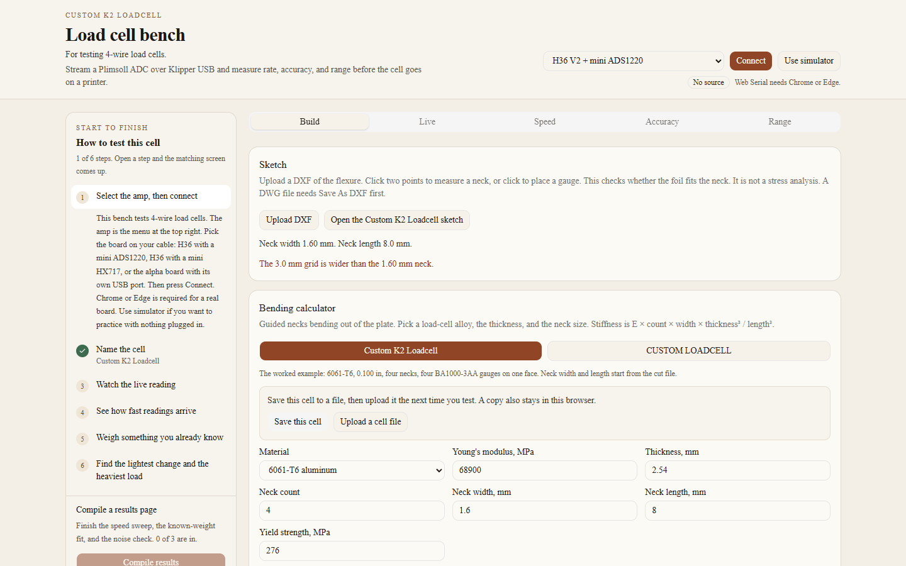

# Load cell bench

The load cell bench is a browser app for checking a 4-wire load cell before it goes on a printer. It talks to a Plimsoll amplifier running Klipper over USB, or it runs a built-in simulator, and it measures three things: how fast the readings arrive, how straight they are against weights you already trust, and how much load the cell can take before the converter saturates or the zero fails to come back. You read those results, then you decide whether the cell is ready for a nozzle probe or an extrusion force trace.

AI disclaimer. This app, this readme, the wiki, and the Custom K2 Loadcell were written with the help of AI tools. Treat the pin maps, the cut file, the bending numbers, and the pass limits as a starting point. Measure the cell you built, and read the drawing, before you cut metal, order a board, or send the cell to a printer. A pass in the simulator is not a measurement of the metal.



The wiki walks every screen in the order you test a cell, with a screenshot of each one: [wiki/README.md](wiki/README.md). The Custom K2 Loadcell plate is a hardware sub-project there, with its own build guide.

A bench for any full-bridge load cell. The bridge plugs into a [Plimsoll](https://github.com/mulcmu/Plimsoll) ADC, which is either a mini board on a [FYSETC H36 Combo V2](https://github.com/FYSETC/H36_Combo_V2) or an alpha board with its own USB port. The K2 plate in this repo — laser-cut 6061-T6, four BA1000-3AA gauges, Loctite 401 under Loctite 9460 — is one worked example, not the only cell the tests accept.

The board runs Klipper. This program speaks Klipper’s USB protocol from the browser and counts the samples that come back. It is the check you run before the cell goes on a printer. Three fronts are wired up:

- H36 + mini ADS1220
- H36 + mini HX717
- Alpha USB + HX717 (STM32F072, SCLK PC1, DOUT PC2)

The 4-channel ADS131M04 under-bed board is not part of this bench.

## Run it

Chrome or Edge. Web Serial is how the page reaches the board. Firefox and Safari can still open the simulator.

```bash
npm install
npm run dev
```

Open [http://127.0.0.1:4471](http://127.0.0.1:4471).

A small launcher window can do that install, start the server, and open the page. On Windows, double-click `launcher/LoadCellBench.exe`.

- **Install** runs `npm install` and `npm run build`. The button then reads **Uninstall**, which removes `node_modules` and the Next.js build.
- **Run** starts the server on port 4471 and opens http://127.0.0.1:4471 in the default browser. Run again while it is up opens the page a second time.
- **Close** stops the server and closes the window. The title-bar button does the same.

Node.js 18.18 or newer has to be installed already. The launcher uses a Node that includes npm, and it skips a Node that was bundled with another tool when a normal install is on the machine.

On a Mac, double-click `launcher/Load Cell Bench.command`. That opens Terminal and the same window. On Linux, run `launcher/loadcell-bench.sh`. `launcher/build.sh` freezes a native binary on that computer. Linux also needs the `python3-tk` package for the window.

`npm test` checks the Klipper frame codec against Klipper’s own byte encoding, the ADS1220 register image, the HX717 gain channels, and the speed / accuracy / range math.

## What you can measure

- **Live.** Counts, grams after tare, noise, and a scrolling trace. On the ADS1220, auto gain walks 1× to 128× and stops before a bridge offset hits the rail. On the HX717 the gain is A-128 or A-64 and is chosen when you connect. Invert the sign if pressing the nozzle side goes the wrong way.
- **Speed.** Asks the ADS1220 for each sample rate, or times the HX717 against its solder-jumper choices (10, 20, 80, 320 Hz). A pass is within 8% of the setting, with no MCU overflows, no missing USB blocks, and counts that are not stuck. A real HX717 passes only the jumper that is fitted. The alpha board’s internal clock can also show up here as chip errors.
- **Accuracy.** Capture the empty cell and known masses, or type mass and counts from a notebook. The fit is counts = offset + counts-per-gram × mass. Unload the same masses for hysteresis, repeat one mass for scatter, and hold for 30 seconds to see adhesive creep.
- **Range.** Eight seconds unloaded for the noise floor, or a noise rms you type in counts. Then step the load until the ADC saturates or the zero does not come back. A rated capacity on the Build tab is the ceiling you set; it does not replace the return-to-zero check.

The Build tab has a bending calculator for the alloys load cells are usually cut from: 6061-T6, 2024-T3, 7075-T6, 17-4 PH H900, and alloy steel. You give it thickness and the neck width, length, and count. It reports Young's modulus, guided-leaf stiffness, and a yield load when the yield is known.

The bending calculator starts on the Custom K2 Loadcell: 6061-T6, 0.100 in, four necks, gauges on one face, and the simulator's starting scale. CUSTOM LOADCELL leaves the alloy, thickness, necks, and gauge blank. Save this cell downloads a file and keeps a copy in the browser. Upload that file on a later visit.

The Build tab also takes a DXF sketch. Click two points to fill a neck width or length, or click to place a gauge and see whether the grid fits the neck. DWG files need Save As DXF first. The click check is a fit, not a stress analysis.

The gauge card takes BA1000-3AA, a 350 Ω foil, or a custom factor. A half bridge or a quarter bridge scales the output for arms that are completion resistors. A scale you type, or a fit you apply, replaces the sketch in the simulator and on the live grams.

A guide along the left starts with the amp menu at the top right: pick the board, then Connect or Use simulator. After that it walks through naming the cell, the live counts, and speed, accuracy, and range. On a narrow screen that guide sits above the tabs and can be hidden. When those three tests have results, Compile results opens one page in plain language. Print it from the browser if you want a copy.

## Wire it

Flash the H36 for USB before connecting it here:

- Micro-controller: STM32
- Processor: STM32G431
- Bootloader offset: no bootloader
- Clock: 12 MHz crystal
- Communication: USB on PA11/PA12
- GPIO pins set at startup: `PA2`

Leave ADS1220 and software SPI enabled. Both are on in a normal Klipper build.

The Plimsoll mini ADS1220 on an H36 Combo V2 uses software SPI:

| Signal | Pin |
| --- | --- |
| CS | PA14 |
| DRDY | PA1 |
| SCLK | PB7 |
| MOSI | PA13 |
| MISO | PA15 |

PA13 is the MOSI pin on that header. PB13 is the heater MOSFET.

The mini HX717 on the same V2 header is not SPI. SCLK is PB7 and DOUT is PA15. The rate is a solder jumper, 320 Hz unless you moved it. Gain in the config is `A-128` or `A-64`.

The menu also has H36 Combo (v1). That 2×6 header is not the V2 header. The mini ADS1220 uses hardware SPI `spi1a`: CS PB6, DRDY PC13, SCLK PB3, MOSI PB5, MISO PB4. The mini HX717 uses SCLK PB3 and DOUT PB4. Flash the v1 board as STM32G0B1, USB on PA11/PA12, startup pin `PA2`.

The alpha board is its own MCU. Flash it as STM32F072, no bootloader, internal clock, USB on PA11/PA12. Optional startup pin PC7 for the power LED. The HX717 on that board uses SCLK PC1 and DOUT PC2. The internal clock is what the published sample config uses, and it can time out a probe; the speed test is where that shows up.

The four-conductor cable in the build photos (red, green, blue, black) lands on the mini board’s E+, E−, S+, and S− pads. This program does not assume which color is which. If the sign is backwards, invert it in the live panel. Do not swap excitation with signal.

Klipper on the printer and this bench cannot share the USB port. Disconnect here before starting the printer.

## After the bench

The Build tab downloads a `load_cell` snippet named after the cell, with the gain, rate, and, once you apply a calibration or type a scale, `counts_per_gram`. On the printer:

1. `LOAD_CELL_DIAGNOSTIC`
2. `LOAD_CELL_CALIBRATE`
3. `LOAD_CELL_TEST_TAP` before a real probe
4. Keep the nozzle near 140°C while probing so ooze is not the thing you touch

Pressure advance is not computed here. If the range test calls the cell a force-trace candidate (about 1.5 g of 3-sigma noise at 330 Hz or faster, and the zero comes back), an extrusion force trace is worth logging. Mainline Klipper does not turn that trace into a pressure-advance value by itself.

## The K2 plate

`hardware/NewLoadcell.dxf` is the cut file for the example cell. The plate is 38 × 24 mm, 0.100 in thick. The drawing is in millimeters. Other designs skip the DXF and type their own measurements. The plate and its build notes are a separate open-hardware project: [wiki/hardware/custom-k2-loadcell/README.md](wiki/hardware/custom-k2-loadcell/README.md).

## License

The bench application, the launcher, and the user guide are under the [MIT License](LICENSE).

The Custom K2 Loadcell design, the cut file, and the hardware pages in the wiki are under the [CERN Open Hardware Licence Version 2 - Permissive](hardware/LICENSE-CERN-OHL-P-2.0.txt). That is the permissive CERN hardware licence: you can study, modify, share, and make the plate, including in a product you sell. The full text is in that file, and CERN asks that it stay unmodified.
