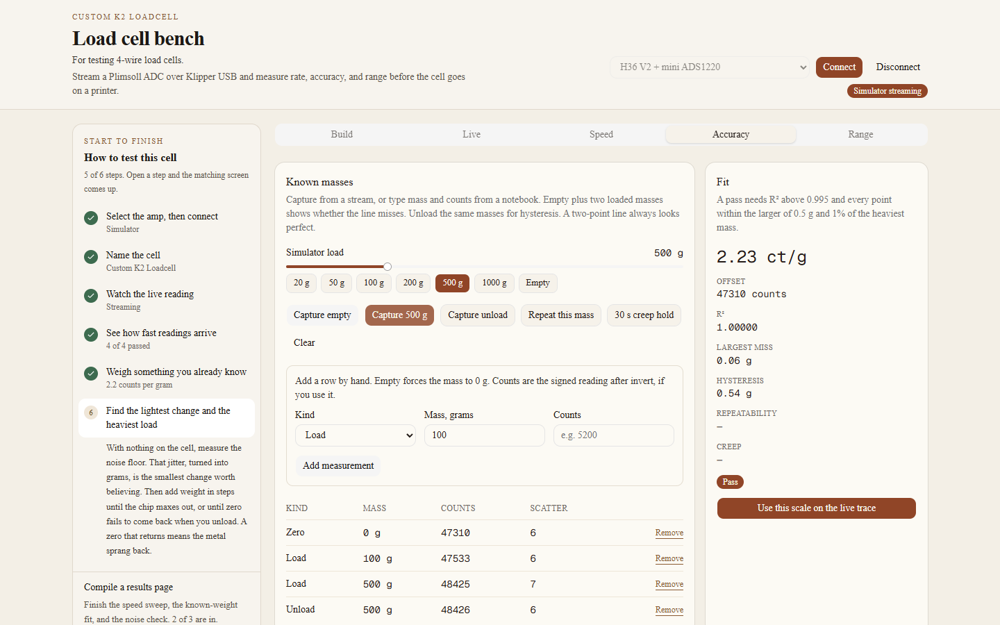

# Weigh something you already know

The fit is a straight line: counts = offset + counts per gram × mass. You need the empty cell and at least one known load. Points that are all the same mass cannot define a line. A two-point line always looks perfect. Empty plus two loaded masses shows whether the line misses.

## Capture from the stream

The stream has to be running, and the cell has to be still. The mass for a load is the simulator slider, or the grams you type when a board is connected. The counts are the mean of about the last 1.2 seconds. The headline on Live uses about the last 0.45 seconds, so the two will not match digit for digit while a reading is settling.

- Capture empty records 0 g.
- Capture load records the mass on the cell.
- Capture unload records the same mass on the way down.
- Repeat this mass records another point at that mass, for scatter.
- 30 s creep hold watches one load for 30 seconds.
- Clear drops the points.

A reading that is still moving is refused. Wait until it holds, then capture again.

## Type a row

Add a row by hand when the numbers are in a notebook. Kind is zero, load, unload, or repeat. A zero row forces the grams to 0. Counts are the signed reading after invert, if you use it. Remove drops one row.

## The fit card

Fit the line by having enough points. The card then shows counts per gram, the offset, R², the largest miss, hysteresis, repeatability, and creep.

The verdict passes when:

- R² is at least 0.995.
- The worst point, in grams, is no larger than the bigger of 0.5 g and 1% of the heaviest mass in the set.
- Counts per gram are positive.

Hysteresis is the worst disagreement between a load capture and an unload capture at the same mass. It is called out when it exceeds 2% of the heaviest mass. It does not by itself fail the straight-line check. Glue does this. Loctite 401 under a thick Loctite 9460 coat is a common reason the way down does not match the way up.

Repeat is the scatter of captures at one mass. Creep is the 30 second hold. The simulator models creep as 0.3% of the load with an 18 second time constant, plus a short mechanical settle. A real cell’s creep is whatever the metal and the adhesive do.

Use this scale on the live trace sets the live scale and the tare offset from the fit. A scale you typed by hand is kept across a reconnect. A sketch scale is not.

Next: [find the lightest change and the heaviest load](range.md).
