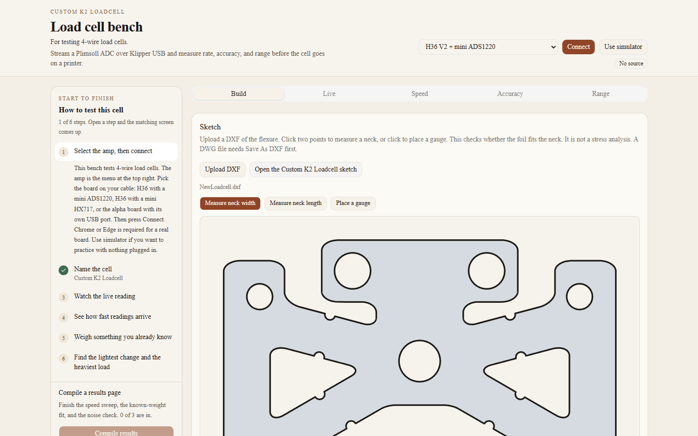
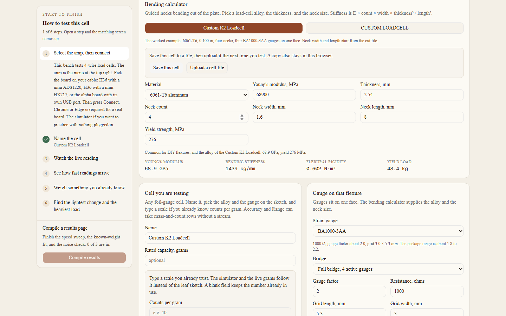
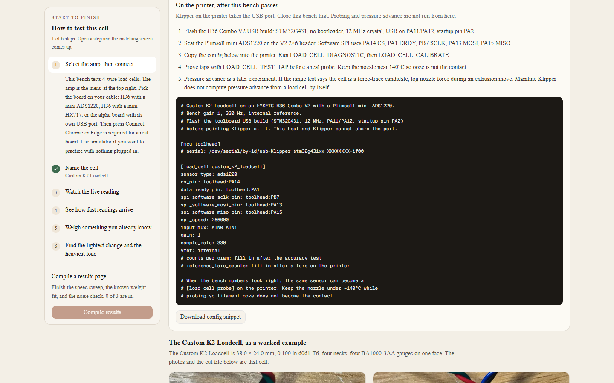

# Name the cell

Build is where the cell is described, saved, and turned into a starting scale. It does not talk to the board. You can fill it in before or after you connect.

## The two starting cells

Custom K2 Loadcell fills a real example: 6061-T6, 2.54 mm thick (0.100 in), four necks 1.6 mm wide and 8 mm long, four BA1000-3AA gauges on one face, 1000 Ω, gauge factor 2.0, grid 3.0 × 5.3 mm, full bridge. Those neck sizes are starting measures from the cut file. Change them if you measure the metal.

CUSTOM LOADCELL clears the name and every measurement. Stiffness and counts are not invented from blanks. The form tells you what is still missing. Gauge placement stays unset until a cell file supplies it. The Custom K2 profile records the gauges as on one face.

## Sketch

Upload DXF reads an ASCII DXF. Units come from `$INSUNITS` when they are inches, millimeters, centimeters, or meters. A unitless file is read as millimeters. Binary DXF is refused. A `.dwg` file is refused with a note to use Save As DXF.

Open the Custom K2 Loadcell sketch loads `NewLoadcell.dxf`. The plate is 38 × 24 mm. Closed paths inside the outline are the laser cuts.

Three tools use clicks:

- Measure neck width. Two clicks. The distance is written into neck width.
- Measure neck length. Two clicks. The distance is written into neck length.
- Place a gauge. The first click is the center. The second click aims the long axis. Clear gauges removes the marks.

The fit line compares the gauge grid with the neck you typed. A 3.0 mm grid on a 1.6 mm neck warns that the grid is wider than the neck. That warning is a fit check. It is not a stress analysis.

## Bending calculator

Once thickness, neck width, neck length, neck count, and a modulus are filled in, the calculator reports Young’s modulus, guided-leaf stiffness in kilograms per millimeter, flexural rigidity, and a yield load when a yield strength is known.

The stiffness used here is `k = E × n × w × t³ / L³`, with `E` in MPa and the neck sizes in millimeters. The necks act as guided leaves in parallel. This is a sketch of that kind of flexure. It is the wrong model for a column, a shear beam, or a diaphragm.

| Alloy | Young’s modulus | Yield used here |
| --- | --- | --- |
| 6061-T6 aluminum | 68.9 GPa | 276 MPa |
| 2024-T3 aluminum | 73.1 GPa | 345 MPa |
| 7075-T6 aluminum | 71.7 GPa | 503 MPa |
| 17-4 PH H900 | 197 GPa | 1170 MPa |
| Alloy steel | 200 GPa | You type it |
| Custom material | You type it | You type it |

These are handbook typicals. If your sheet differs, choose Custom material and type the numbers.

## Gauge, bridge, and scale

Gauge presets are BA1000-3AA, a 350 Ω foil, and a custom gauge. The gauge factor is what the math uses. A package range of about 1.8 to 2.2 around a nominal 2.0 is normal. Resistance does not change counts per gram. It changes how warm the foil gets at a given excitation.

Bridge:

- Full. Four gauges change with the load.
- Half. Two gauges change. The other two are fixed resistors. The sketch uses half the full-bridge output.
- Quarter. One gauge changes. The sketch uses a quarter of the full-bridge output.

Share of peak strain defaults to 1, which means the foil is assumed to see the peak. If the grid is no longer than half the neck, Use root-grid average fills the share a root-bonded grid actually averages, because the moment falls off along the neck. If the grid is longer than half the neck, the button leaves the peak in place until you type a share. The BA1000-3AA grid is 5.3 mm. On an 8 mm neck that is more than half.

Use this sketch as the live scale only when the necks, thickness, modulus, gauge factor, and bridge are filled in. A scale you type in Counts per gram, or a line you fit on Accuracy, replaces the sketch. Editing the sketch afterward does not overwrite that measured scale.

Rated capacity is a ceiling you type. The range test mentions it. It does not pass or fail the cell by itself.

## Save, upload, and the printer snippet

Save this cell downloads a JSON file and keeps a copy in this browser under `loadcell-bench.cells`. Up to 24 cells are remembered. Saving the same name again replaces that entry. The buttons under the save controls restore a remembered cell. Remove drops one from the browser only. It does not delete the file you already downloaded.

Upload a cell file reads that JSON back. The file has to be one this bench wrote: `kind` is `loadcell-bench-cell` and `version` is `1`. It restores the name, the alloy and neck fields, the gauge, the bridge, any counts per gram and tare, and any gauge marks. The DXF itself is not inside the file. Upload the drawing again when you want the picture.

The bottom of Build shows a Klipper `load_cell` snippet for the board you selected. The section name is a slug of the cell name. `counts_per_gram` is filled in after a calibration or a typed scale. Until then the line is a comment. Copy it to the printer after you disconnect this bench.

The photos and the outline under that card are the Custom K2 Loadcell. Their build is a separate project: [Custom K2 Loadcell](hardware/custom-k2-loadcell/README.md).

Next: [watch the live reading](live.md).
