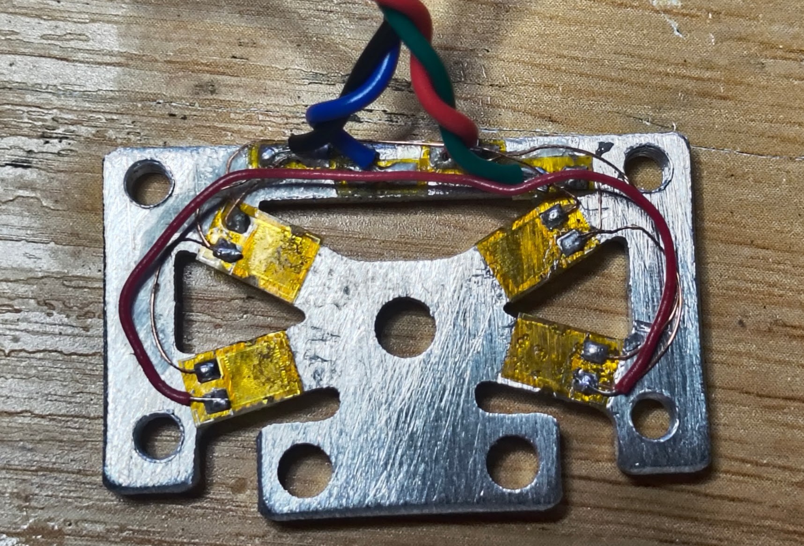
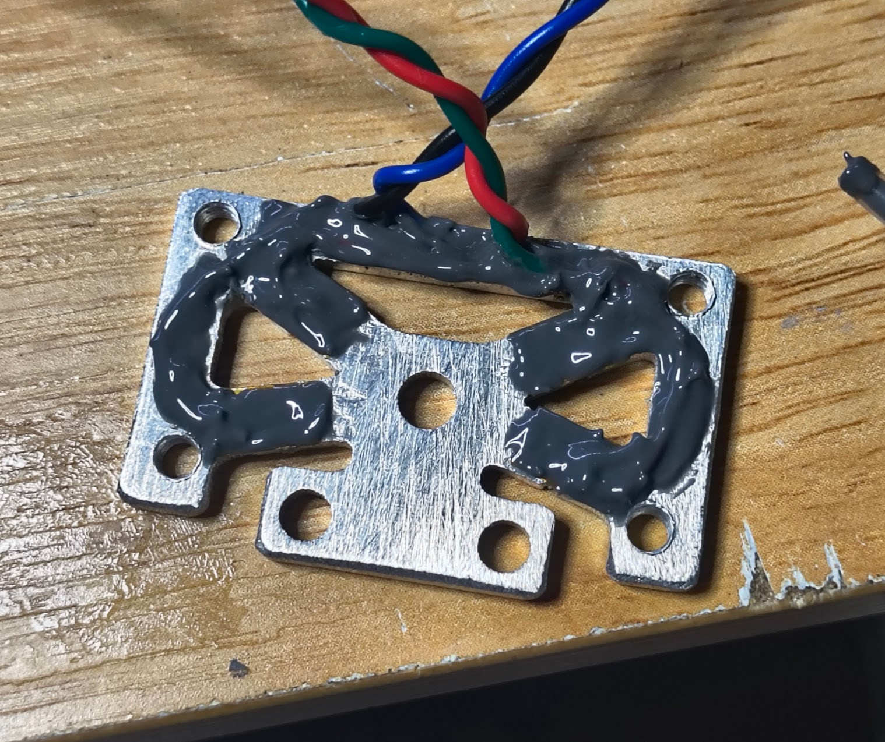

# Build the Custom K2 Loadcell

Cut the plate, bond four gauges as a full bridge, then coat them. The jumper wires in the photos are the wiring this build uses today. The [flex PCB](flex-pcb.md) is the board that replaces those jumpers. Ordering it is on the [loadcell page](README.md#order-the-flex).

## Cut

Use [`hardware/NewLoadcell.dxf`](../../../hardware/NewLoadcell.dxf). The drawing is in millimeters. The outline is 38 × 24 mm. Closed paths inside the outline are the laser cuts: the windows, the slot, and the mounting holes. The stock is 0.100 in 6061-T6, which is 2.54 mm.

Deburr the necks before you bond anything. A nick in a 1.6 mm neck is a crack waiting for the first overload.

## Gauges

Four BA1000-3AA foils. Each is 1000 Ω, gauge factor about 2.0, active grid 3.0 × 5.3 mm on a carrier about 6.7 × 6.5 mm. The 3.0 mm grid is wider than a 1.6 mm neck. The Build tab warns about that fit. Line the grid up with the neck as well as the carrier allows, with the long axis of the grid along the neck.

Bond with Loctite 401. It grabs fast and it creeps. The 30 second hold in the bench is there to show that creep.

A full bridge needs two gauges whose resistance rises under the load and two whose resistance falls. On a guided neck the bending moment falls to zero at midspan and has the opposite sign at the other root, so two gauges on one face, one at each end of a neck, see opposite strain. That is a valid single-sided bridge. Two gauges sitting in the same moment, both pointing the same way, move together. The sense wires then step the same direction and the difference stays flat. Put the two gauges of one neck at opposite ends.

Wire two dividers between excitation+ and excitation−. Each divider is excitation, a gauge, a sense wire, a gauge, and excitation again. The two sense wires are signal+ and signal−. Looking from the amplifier, one diagonal of the diamond is excitation and the other diagonal is signal.

The cable in that photo has four conductors, which is the right count for a bridge. Land them on the amplifier’s E+, E−, S+, and S− pads. This project does not assign a color to a function. With the cell unplugged, the two pairs that read the higher resistance are the diagonals. One diagonal is excitation. The other is signal. Swapping the two wires inside one pair only flips the sign, and Invert sign in the bench fixes that. Swapping a diagonal for the other diagonal is a different bridge.

Keep the excitation pair on E+ and E− and the signal pair on S+ and S−. The mini board’s connector is pin 1 E+, pin 2 E−, pin 3 S−, pin 4 S+.

## Coat

Cover the gauges and the jumper wires with Loctite 9460. The coat protects the grid and it changes the stiffness until it has cured. Let it finish curing before you trust a zero.

## Then test it

Open the bench, press Custom K2 Loadcell, and follow the [wiki](../../README.md) from connect through the results page. On an ADS1220, set the reference to the analog supply. The mini board excites the bridge from 3.3 V. Check wiring on the Live tab is the first look at whether the two sense wires move in opposite directions.
