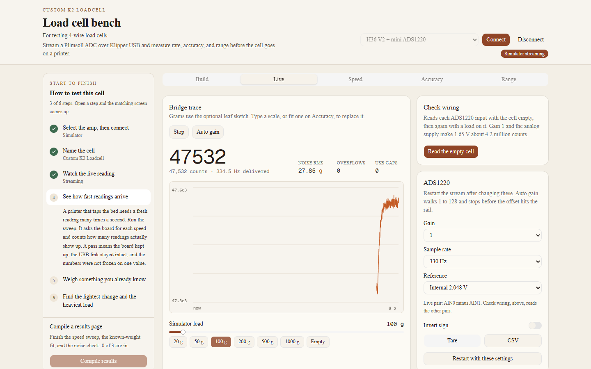
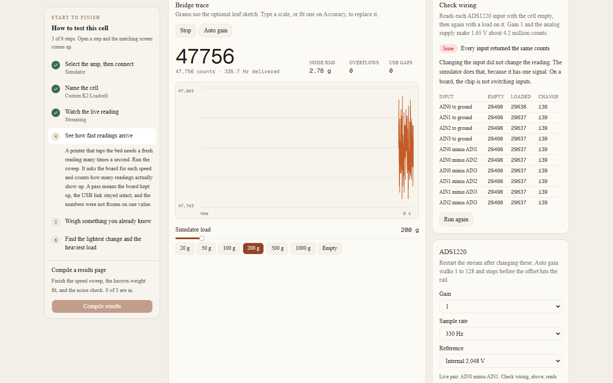

# Watch the live reading

Start stream asks the board for samples. Stop ends that request. The large figure is grams when a scale exists, and counts until then. The line under it is the full integer count, plus the rate actually arriving. That rate is sample index over host time.

Noise rms is the jitter while the recent window sits still. Overflows count MCU buffer overruns. USB gaps count missing bulk-data blocks. Chip errors appear on an HX717 when a read desyncs or runs long.

On the simulator, the load slider and the gram buttons are the force. Empty is zero.

## ADS1220 settings

The live pair starts as AIN0 minus AIN1, at gain 1, so a mid-scale offset does not sit on the rail. The menus are:

- Gain: 1, 2, 4, 8, 16, 32, 64, 128.
- Sample rate: the normal set (20, 45, 90, 175, 330, 600, 1000 Hz) and the turbo set (40, 90, 180, 350, 660, 1200, 2000 Hz). Turbo is a register bit.
- Reference: internal 2.048 V, or the analog supply. The Plimsoll mini board excites the bridge from its 3.3 V analog rail, so the ratiometric choice is the one that matches that board.

Auto gain walks 1 through 128 and stops before the unloaded offset hits the rail. Saturation is about 8.2 million counts, near the 24-bit full scale of ±8388607. Restart with these settings writes the menus again. Starting the stream resets the chip, writes the registers, and reads them back. If the reset does not read as zeros, or the write does not stick, the error names the pins.

## Check wiring

Check wiring is on the Live tab, above the ADS1220 card. The Load cell menu picks the cell you are testing. The steps under it are the wiring for that choice. The HX717 has no input mux, so the card still shows the wiring and hides the pin reads.

The choices are a full Wheatstone bridge, a half bridge, a quarter bridge, and a three-gauge series string. Full, half, and quarter also set the Build tab bridge, which is the predicted scale. The three-gauge series sets that bridge to half, because the test is one span completed with two resistors.

Read the empty cell, then put a steady load on and read it again. The check uses gain 1 and the analog supply, so about 1.65 V is about 4.2 million counts. It reads each pin to ground and each pair. What counts as wired depends on the menu:

- Full Wheatstone. The two sense wires move in opposite directions and the difference stays near the middle.
- Half bridge, quarter bridge, or one span of a three-gauge series. One midpoint moves, the resistor midpoint stays, and the difference stays near the middle. Two wires that move apart are a full bridge, and the check says so.
- The sense wires move the same way, so the difference barely moves. On a full bridge, trade the two gauges in one divider. On a three-gauge series, that span’s two gauges have the same strain sign: wire the other span.
- One pin moves, excitation is missing, nothing moved, or the readings never changed from one input to the next.
- On the three-gauge series, a difference that rests near 4.2 million counts is the two twist pairs used as the diagonals. That is not the span test.

On a real ADS1220 the inputs are different pins. The simulator has one signal, so the badge says Issue and the table barely changes. That result means the check ran. It does not describe your bridge. Use it on the board.

The live trace then follows the pair the check names, when it found one.

## The other controls

Tare averages about the last second, and only if the reading is holding still. A reading that is still moving is refused.

Invert sign multiplies the displayed grams by −1. The raw counts in the log stay as the chip sent them. The fitted scale is expected to come out positive. If a fit is negative, turn Invert on and capture again.

CSV downloads the samples on the chart.

The link log is the running text of connects, resets, and test lines.

## HX717

Start stream only starts watching the data-out pin. Gain is A-128 or A-64, chosen when you connect. The sample-rate menu is the solder jumper you want the speed sweep to check, not a register. Mini boards leave the factory at 320 Hz. There is no reference menu: the HX717 is ratiometric. Check wiring still shows how to land the selected cell, and it does not scan pins. Chip errors join the noise, overflow, and gap figures.

Next: [see how fast readings arrive](speed.md).
