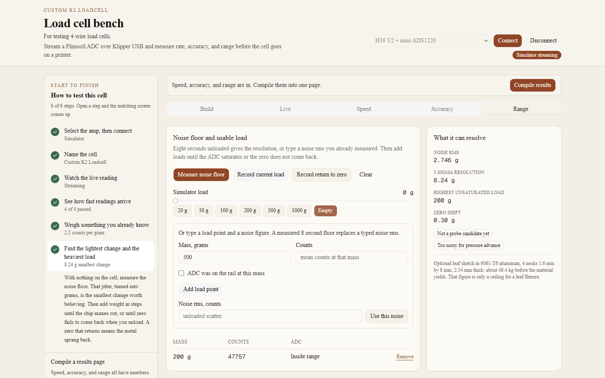

# Find the lightest change and the heaviest load

Range turns noise into a smallest believable change, and walks the load upward until the chip or the metal gives up.

## Noise

Measure noise floor while the cell sits empty for about eight seconds. On the simulator, set the load to Empty first. You can also type a noise rms in counts and press Use this noise. A measured floor replaces a typed one.

Three times the rms, in grams, is the smallest change the report tells you to trust. That needs a counts-per-gram. Without a scale, the noise stays in counts.

## Steps of load

Add weight in steps. Record current load takes the mass on the slider, or the grams you type, once the reading holds still. You can also type a mass and a count and press Add load point, and tick ADC was on the rail at this mass when the converter was already against the stop.

Each row records grams, counts, and whether the ADC was inside range or saturated. The heaviest step that was still inside the converter is the top of the electrical range at this gain. A saturated step means this gain is out of room. Drop the gain, or stop. Dropping the gain on an ADS1220 needs a new stream. Dropping it on an HX717 needs a new Connect.

Unload and press Record return to zero. If the zero moved by more than the larger of five times the noise or 1 g, the metal or the adhesive took a set. Stop adding load after that.

Clear drops the steps.

## What it can resolve

The side card reports noise rms, 3-sigma resolution, the highest unsaturated load, and the zero shift.

A nozzle-probe candidate wants 3-sigma noise at or under 5 g, a passing speed of at least 175 Hz, and a zero that came back. A force-trace candidate wants 3-sigma noise at or under 1.5 g and at least 330 Hz, and a zero that came back. The force-trace line is only offered when the noise is already in grams. These are bench gates. They are not a probe and they are not a pressure-advance value.

If you typed a rated capacity on Build, the card repeats it. A recorded load past that capacity is called out. The return-to-zero row is what tells you the cell came back. The yield line, when the bending sketch has a yield strength, is only a ceiling for a leaf flexure.

Next: [compile the results](results.md).
