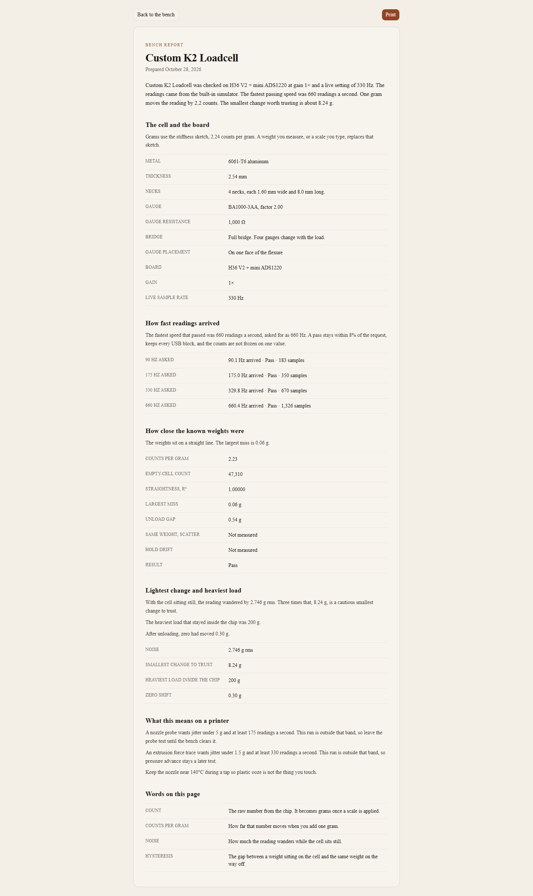

# Compile the results

Compile results stays off until speed, accuracy, and range each have a result. The button is in the left-hand guide and, once the three tests exist, in a bar above the tabs.

The page is one report:

- A lede: cell name, board, gain, the live rate, whether the numbers came from the simulator or from USB, the fastest passing speed, counts per gram, and the smallest change worth trusting when those exist.
- The cell and the board, including anything you left blank, which is printed as not entered or not chosen. Gauge placement is on one face for the Custom K2 profile.
- Speed, accuracy, and range, each in sentences and a small table.
- What this means on a printer.
- A short glossary: count, counts per gram, noise, hysteresis.

Print hides the guide and the buttons. Save a PDF from the browser’s print dialog if you want a file. The app does not store the report on a server.

## After the bench, on the printer

Disconnect this page first. Copy the snippet from Build into the printer config, set the serial path, and restart Klipper. Then:

1. `LOAD_CELL_DIAGNOSTIC`
2. `LOAD_CELL_CALIBRATE`
3. `LOAD_CELL_TEST_TAP` before a real probe
4. Keep the nozzle near 140°C while probing, so ooze is not the contact

Mainline Klipper does not compute pressure advance from a load cell. If the range page calls the cell a force-trace candidate, an extrusion force trace is worth logging. The trace is data. Pressure advance stays a setting you choose.

If a step failed, see [when Connect or a test fails](troubleshooting.md).
