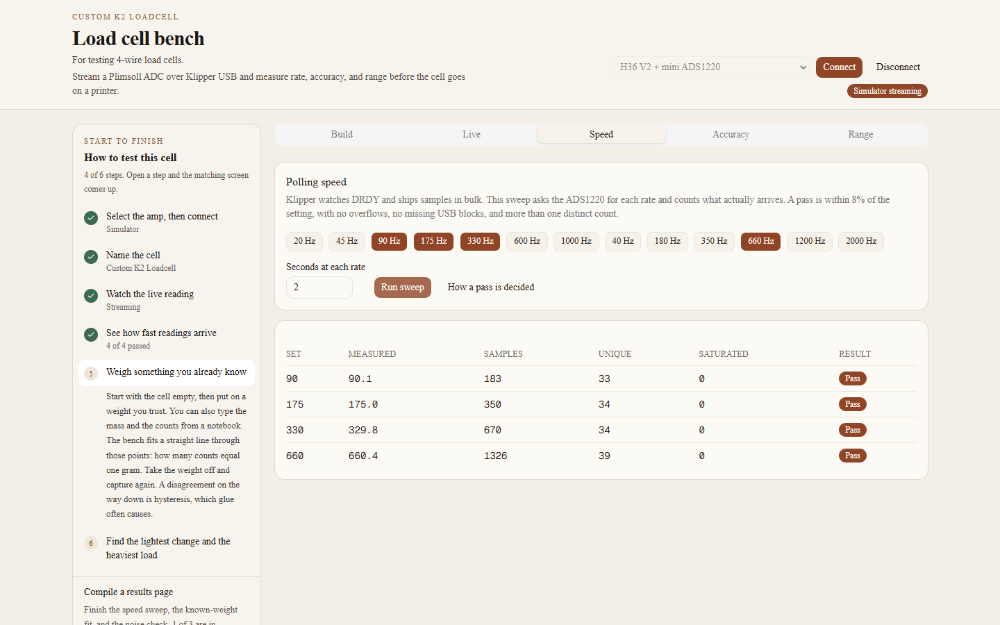

# See how fast readings arrive

The sweep asks for each highlighted rate and counts what comes back. Toggle a rate to leave it out. Seconds at each rate runs from 2 to 15. The default sweep on an ADS1220 is 90, 175, 330, and 660 Hz.

ADS1220 rates you can add are the rest of the normal set (20, 45, 600, 1000) and the turbo set (40, 180, 350, 1200, 2000). Ninety hertz appears once. It is the normal setting, not a second turbo chip.

HX717 rates are 10, 20, 80, and 320 Hz. A real chip passes only the jumper that is fitted. The simulator can hit every rate, because it is not a solder joint.

A rate passes when all of these are true:

- Samples arrived.
- The measured rate is within 8% of the rate you asked for.
- There were no MCU overflows and no missing USB blocks.
- An HX717 reported no chip errors.
- No more than about 1% of samples are against the rail.
- The counts are not frozen on a single value. One unique count means the bridge or the SPI wires are not moving the chip.

175 Hz is the floor used later for a nozzle probe. 330 Hz is the floor used later for an extrusion force trace. A pass at a slow rate does not make a fast rate pass.

How a pass is decided opens the same bars the three tests use: 8% on rate, R² of at least 0.995, the larger of 0.5 g and 1% of the heaviest mass, hysteresis called out above 2%, a probe candidate near 5 g of 3-sigma noise at 175 Hz, and a force-trace candidate near 1.5 g at 330 Hz. The zero has to come back for either candidate.

Next: [weigh something you already know](accuracy.md).
